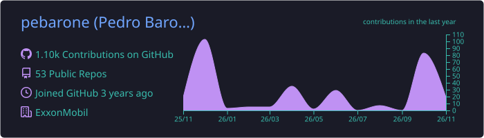
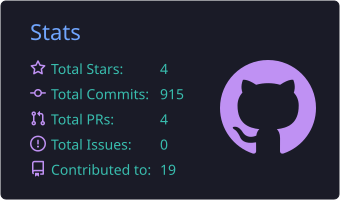
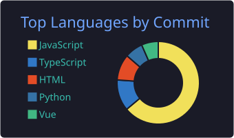
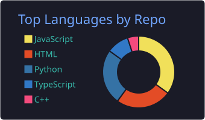
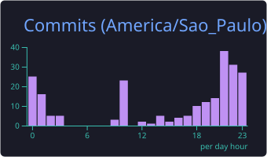

<h1 align="center">Hi, I'm Pedro Barone 👋</h1>

  <b>Software Engineer · OpenText Extended ECM · Automation & Integrations</b> 
  São Paulo, Brazil · working remotely for global teams

  
  
  

---

### About me
I pair **OpenText Content Server / Extended ECM** expertise with software engineering: I build REST APIs, integrations, migration tooling and container deployments, with a product mindset and ownership.

- **Software Engineer & ECM Data Analyst** at **Dexian · ExxonMobil** (remote, US), since Sep 2025
- Part-time **independent consultant** at **Stratesys**, where I worked as a software engineer from 2021 to 2025
- B.Sc. **Software Engineering** at **FIAP** (2023 – 2026)
- Lately building **AI agent tooling**: CLIs, agent skills and multi-agent workflows
- Portuguese (native) · English (fluent) · Spanish (advanced)

### Highlights
- **InfoArchive Toolkit**: full-stack app (Python, JavaScript) that automates legacy data archiving. It sped up decommissioning workflows by **35%** and migrated **22 TB** in 6 months, with recognition from senior management.
- **Content Server migration tool** in TypeScript that carries metadata, retention and audit info between environments while keeping compliance.
- Dockerfiles, OpenShift and Helm behind a CI/CD pipeline, cutting deployment lead time by **50%**.
- Node.js/Express backend for an **OpenText + Adobe Sign** integration, fully auditable, with persistent OAuth2 for 24/7 continuity.
- Python automation over REST APIs, up to **77%** faster critical tasks, and 25+ SQL reports for PwC and Vale optimized by **62%+**.

### Side projects
- **InfoArchive CLI & agent skill**: lets AI agents operate OpenText InfoArchive and run tasks in parallel.
- **Multi-harness agent tool**: connects Codex, Claude, Gemini and Grok with persistent sessions, cross-agent delegation and four specialist agents (exploration, backend, frontend, diagnostics).

### Tech stack

  

  
  
  
  
  
  
  
  
  
  
  

### GitHub stats

  

  
  

  
  

Cards are generated daily by a GitHub Actions workflow in this repository.
